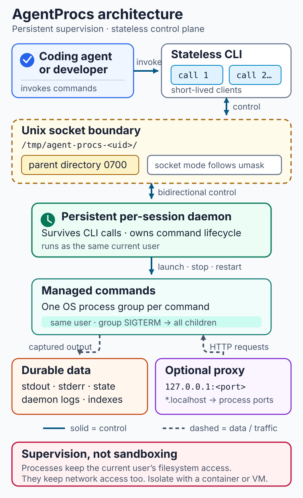

# Architecture and security boundary

Each CLI command (see the [README](../README.md) example) is a short-lived client, while a per-session daemon persists across invocations and owns the control plane. CLI requests cross a Unix domain socket whose `0700` parent directory limits access to the current user; the daemon supervises process groups, durable session logs, and the optional [reverse proxy](reference.md#reverse-proxy).

AgentProcs provides process supervision, not sandboxing: managed commands retain the current user's filesystem and network access. Use a container or VM when isolation is required; see [Sessions](reference.md#sessions) for operational separation and [SECURITY.md](../SECURITY.md) for the complete security model.
